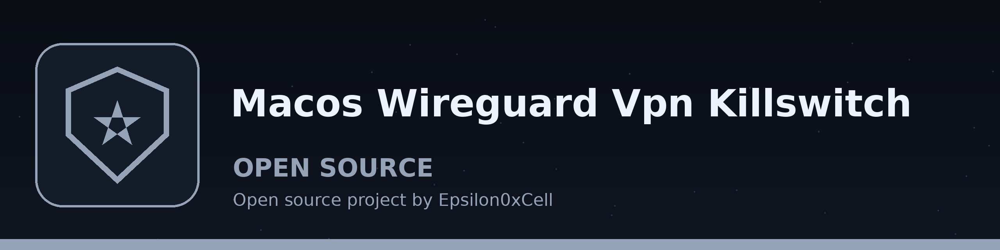

# MacOS WireGuard VPN Killswitch

Two Bash scripts for macOS that use the pf firewall (`pfctl`) as a
killswitch for a WireGuard VPN connection:

- `killswitch.sh` loads a pf ruleset that blocks all traffic except
  traffic leaving through the WireGuard interface, enables pf, and
  then monitors the interface every 5 seconds.
- `unkillswitch.sh` disables pf again to restore normal access.

## How killswitch.sh works

1. The ruleset is loaded in a single `pfctl -f` call containing exactly
   two rules: `block all` and `pass out on <interface> all`. A single
   load matters because every `pfctl -f` load replaces the whole
   ruleset; loading the two rules separately would silently drop the
   first one.
2. pf is enabled with `pfctl -E` only after the ruleset is loaded.
3. Every 5 seconds the script checks whether the VPN interface exists
   (`ifconfig`). When the interface disappears, the ruleset is
   replaced with `block all` alone. When the interface comes back, the
   two-rule killswitch ruleset is loaded again.
4. If any `pfctl` call fails, the script prints an error and exits
   with a non-zero status instead of claiming the killswitch is
   active. The interface name is validated before use, and an invalid
   name exits with status 2.

## Requirements

- macOS with pf (built in)
- WireGuard installed and configured, with the VPN interface up
- Administrative privileges (the scripts call `sudo pfctl`)

## Usage

Set the interface name to your WireGuard interface (default `utun3`)
either by editing the `VPN_INTERFACE` line at the top of
`killswitch.sh`, or through the environment:

```bash
chmod +x killswitch.sh unkillswitch.sh
VPN_INTERFACE=utun4 sudo -E ./killswitch.sh
```

Or, with the default or edited interface name:

```bash
sudo ./killswitch.sh
```

To stop blocking traffic:

```bash
sudo ./unkillswitch.sh
```

## Limitations

- Stopping `killswitch.sh` (for example with Ctrl-C) does not undo
  anything: pf stays enabled with the last ruleset that was loaded.
  Run `unkillswitch.sh` (or `sudo pfctl -d`) to restore normal access.
- `unkillswitch.sh` disables pf entirely (`pfctl -d`), not just the
  killswitch rules. If you rely on pf for other rules, reload your own
  ruleset afterwards instead.
- The ruleset passes traffic only on the VPN interface. It contains no
  exception for WireGuard endpoint handshake traffic on the physical
  interface, and connection detection is based only on whether the
  interface exists, not on whether the tunnel is actually passing
  traffic.
- There is no logging, alerting, or automatic restart. The monitor is
  a simple 5 second poll loop.

## License

GPL-3.0, see the LICENSE file.
